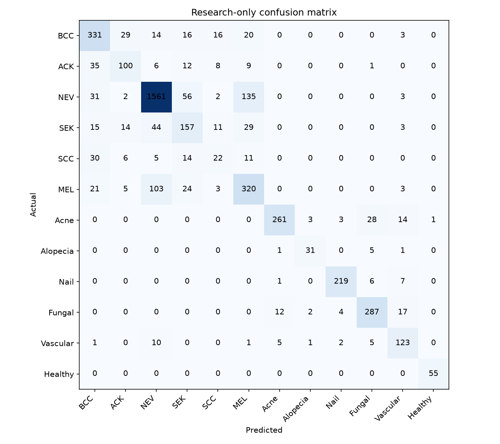

# DermoAI V2

DermoAI V2 is a local, 12-class skin-image research classifier built on **ConvNeXt V2 Base**. This repository includes the selected V2 checkpoint, a drag-and-drop model tester, frozen-test evaluation artifacts, and a detailed evidence-backed model report.

> **Research use only.** DermoAI V2 is not a medical device, diagnostic system, or screening test. Its displayed scores are uncalibrated neural-network outputs, not probabilities that a person has a disease. Seek a qualified clinician for health concerns.

## Run the V2 tester

The checkpoint is stored with Git LFS. Install [Git LFS](https://git-lfs.com/) before cloning or pulling the repository.

```powershell
git lfs install
git lfs pull
python -m venv .venv
& ".\.venv\Scripts\python.exe" -m pip install -r ".\model_tester\requirements.txt"
& ".\model_tester\start.ps1"
```

Open [http://127.0.0.1:7861/](http://127.0.0.1:7861/).

The tester:

- accepts JPG, PNG, WebP, and BMP images up to 16 MB;
- runs locally and does not save uploaded images;
- preserves the exact 12-class checkpoint order;
- displays the complete ranked distribution and raw score for every class;
- does not present an aggregate cancer score or medical diagnosis.

## V2 checkpoint

| Item | Value |
|---|---|
| Architecture | `convnextv2_base.fcmae_ft_in22k_in1k` |
| Input | 224 × 224 RGB |
| Checkpoint | `model_weights/dermoai_v2_convnextv2_base.pth` |
| SHA-256 | `9d0cb9f692397b81ac5527cda06d9d9502056e6edead6440060150b8ce316c21` |
| Selected epoch | 2 |
| Selection source | Validation data only |

The checkpoint contains model and optimizer state, AMP scaler state, run configuration, RNG state, selected epoch, and dataset version metadata. The tester loads only the model state for inference.

## Canonical class order

The index order is part of the checkpoint contract and must not be changed.

| Index | Code | Display name |
|---:|---|---|
| 0 | BCC | Basal Cell Carcinoma |
| 1 | ACK | Actinic Keratosis |
| 2 | NEV | Melanocytic Nevus |
| 3 | SEK | Seborrheic Keratosis |
| 4 | SCC | Squamous Cell Carcinoma |
| 5 | MEL | Melanoma |
| 6 | Acne | Acne and Rosacea |
| 7 | Alopecia | Alopecia and Hair Loss |
| 8 | Nail | Nail Fungus and Disease |
| 9 | Fungal | Fungal Infections |
| 10 | Vascular | Vascular Tumors |
| 11 | Healthy | Healthy Skin |

## Verified evaluation

V2 was evaluated on a frozen 4,336-image local test split.

| Metric | V2 | Legacy CE-LS on same split | Change |
|---|---:|---:|---:|
| Accuracy | 79.96% | 76.59% | +3.37 points |
| Macro-F1 | 75.25% | 73.28% | +1.98 points |
| Cancer-class sensitivity | 77.71% | 68.27% | +9.44 points |
| Cancer-class specificity | 91.71% | 88.68% | +3.02 points |
| Smartphone subset accuracy | 72.15% | — | — |

These same-split results do not establish clinical performance. Patient separation cannot be verified for several source datasets, source labels were not independently reviewed, and the legacy model's historical training membership is unknown.

External performance is the main warning: on the sealed 318-image DDI v1 cohort, V2 reached **28.93% accuracy** and **25.20% cancer sensitivity**. This large domain-shift failure prevents responsible diagnostic or screening claims.



See [`V2_MODEL_REPORT.md`](V2_MODEL_REPORT.md) for the complete methodology, per-class findings, limitations, and prioritized next steps.

## Repository layout

```text
dermoai-final/
├── model_tester/                         # Primary V2 local web app
│   ├── app.py
│   ├── model_runtime.py
│   ├── requirements.txt
│   ├── start.ps1
│   ├── stop.ps1
│   ├── static/
│   ├── templates/
│   └── tests/
├── model_weights/
│   ├── dermoai_v2_convnextv2_base.pth   # V2 checkpoint via Git LFS
│   └── ce_ls_best.pth                    # Legacy CE-LS checkpoint
├── evaluation/v2/                       # Frozen-test metrics and predictions
├── V2_MODEL_REPORT.md
├── app.py                               # Legacy CE-LS Flask app
├── main.py                              # Legacy CE-LS FastAPI app
└── webapp/                              # Legacy CE-LS interface
```

The root `app.py`, `main.py`, and `webapp/` are retained for reproducibility of the original repository model. New testing should use `model_tester/` and the V2 checkpoint.

## Validate locally

```powershell
& ".\.venv\Scripts\python.exe" -m unittest discover -s ".\model_tester\tests" -p "test_app.py" -v
```

The browser smoke test additionally requires Playwright and a locally installed Chromium browser.
